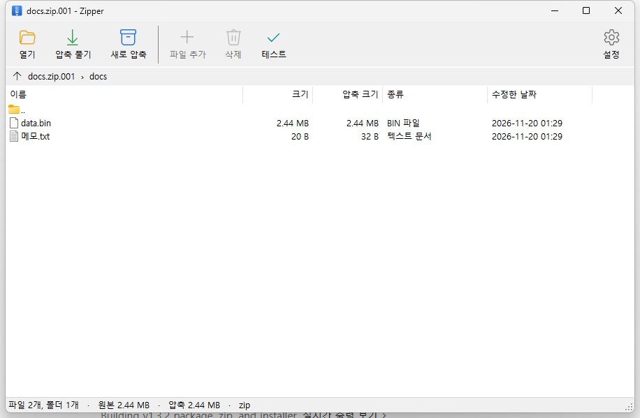

<p align="center">
  
</p>

<h1 align="center">Zipper</h1>

<p align="center">가볍고 깔끔한 Windows 압축 프로그램</p>

<p align="center">Author: <b>Manggdy</b></p>

<p align="center"><a href="README.md">English</a> | <b>한국어</b></p>



Zipper는 zip, 7z, rar, tar, gz, iso 등 20가지가 넘는 형식과 분할 압축 파일을 열고, 풀고, 만듭니다. 내장된 7-Zip 엔진을 쓰는 작은 C# WinForms 프로그램(약 70KB)이며, 탐색기 오른쪽 클릭 메뉴와 파일 연결로 Windows에 바로 붙습니다.

## 다운로드

[Releases](https://github.com/mrkim0118/Zipper/releases/latest) 페이지에서 `ZipperSetup-<버전>.exe`를 받아 실행하세요. 관리자 권한 없이 현재 사용자에게 설치되며, 모든 사용자에게 설치하려면 첫 화면에서 고르면 됩니다.

## 주요 기능

- **폴더처럼 둘러보기**: 압축 파일을 열어 폴더를 오가고, 이름·크기·종류·날짜로 정렬하고, 파일을 두 번 클릭해 바로 엽니다.
- **다양한 형식 풀기**: zip, 7z, rar/rar5, tar, gz/tgz, bz2, xz, zst, lzma, cab, iso, wim, arj, lzh, cpio, rpm, deb, xar, z 등과 알집의 ALZ, EGG(암호·분할 포함).
- **압축하기**: zip, 7z, tar, tar.gz, tar.bz2, tar.xz, gz, bz2, xz, wim 형식, 압축 레벨 6단계(ZIP의 "보통"은 빠른 Deflate 설정이라 다른 압축 프로그램 기본값과 크기는 비슷하면서 몇 배 빠릅니다. 더 작게 만들려면 "높음"이나 "최고"를 고르세요). 7-Zip 엔진이 만들 수 있는 형식은 모두 지원합니다(rar, alz, egg, iso 등은 풀기만 가능). 압축 창에서 고른 파일·폴더 목록을 확인하고 추가·제거하거나 끌어 놓을 수 있습니다.
- **분할 압축**: 원하는 크기로 나눠 압축(10 MB, CD 700 MB, FAT32 4092 MB, 또는 `50 MB`처럼 직접 입력)하고, `.001`, `.z01`, `.part1.rar` 분할 파일을 그대로 엽니다.
- **암호**: zip은 ZipCrypto 또는 AES-256, 7z는 AES-256과 파일 이름 암호화. 틀린 암호는 풀기 전에 걸러내서 빈 파일이 남지 않습니다.
- **알아서 풀기**: 최상위 항목이 하나면 압축 파일 옆에, 여러 개면 압축 파일 이름의 새 폴더에 풉니다.
- **탐색기 메뉴**: 일반 파일·폴더는 압축하기, ZIP/7Z로 바로 압축. 압축 파일은 여기에 더해 알아서 풀기, 여기에 풀기, 각각 새 폴더에 풀기, 다른 위치에 풀기, Zipper로 열기, 압축 파일 테스트. 여러 파일을 골라도 압축 파일 하나로 만들고, 압축 파일 여러 개를 고르면 각각 풉니다. 설치 프로그램 없이도 처음 실행할 때 메뉴가 등록됩니다.
- **EXE 이름 바꾸기 (옵션)**: 메일 첨부가 막히지 않도록 `.exe` 파일을 `.zipper`로 바꿔 압축하고, Zipper가 없는 사람도 되돌릴 수 있게 `EXE 복원하기.bat`을 압축 파일 맨 위에 함께 넣습니다. Zipper로 풀면 `.zipper`를 자동으로 `.exe`로 바꾸고 배치파일은 지웁니다. 기본으로 켜져 있고, 압축 창이나 설정에서 끌 수 있습니다.
- **기본 프로그램 설정**: 설정 창이나 설치 프로그램에서 29가지 압축 형식을 Zipper로 연결합니다.
- **끌어 놓기**: 압축 파일을 끌어 놓으면 열고, 일반 파일은 새로 압축하거나 열린 압축 파일에 추가합니다. 압축 파일 안의 항목을 탐색기로 끌어내 풀 수도 있습니다.
- **편집과 검사**: zip, 7z, tar, wim에 파일을 추가·삭제하고 이름을 바꾸며(F2), 압축 파일 손상을 검사합니다.
- **검색과 최근 파일**: 압축 파일 전체에서 이름으로 찾고(Ctrl+F), 열기 버튼이나 시작 화면에서 최근에 연 압축 파일을 다시 엽니다.
- **항목마다 따로 압축**: 고른 파일·폴더를 각각 따로 압축합니다.
- **진행 표시**: 속도와 남은 시간, 여러 압축 파일을 이어서 처리할 때 "2/3" 표시. 한 압축 파일의 암호를 다음 파일에 먼저 시도합니다.
- **안전한 기본값**: 같은 이름의 파일이 있으면 새 파일 이름을 바꿔 기존 파일을 지킵니다(덮어쓰기·건너뛰기로 바꿀 수 있음). 인터넷에서 받은 압축 파일을 풀면 풀린 파일에도 "인터넷에서 받은 파일" 표시가 남아 SmartScreen과 Office 보호된 보기가 그대로 동작합니다.
- **Mac 한글 이름**: Mac에서 만든 압축 파일의 자모가 분리된 한글 이름을 풀 때 정상 한글로 바꿉니다.
- **업데이트 확인**: 실행할 때 GitHub 최신 릴리스를 확인하고, 새 버전이 있으면 내려받아 설치할지 묻습니다.

## 요구 사항

- Windows 10 또는 11, x64 (ARM64는 x64 에뮬레이션으로 실행)
- .NET Framework 4.8 (Windows 10 1903 이상과 Windows 11에 기본 포함)

## 사용법

시작 메뉴에서 Zipper를 열고, 창에 압축 파일이나 일반 파일을 끌어 놓거나 도구 모음을 쓰세요. 탐색기에서는 파일이나 폴더를 오른쪽 클릭하면 Zipper 명령이 아이콘과 함께 메뉴에 바로 나옵니다(Windows 11은 **더 많은 옵션 표시** 안에 있습니다).

### 단축키

| 키 | 동작 |
|---|---|
| `Ctrl+O` | 압축 파일 열기 |
| `Ctrl+N` | 새로 압축 |
| `Ctrl+E` | 선택한 항목 풀기 (선택이 없으면 전체) |
| `Enter` / 두 번 클릭 | 폴더나 파일 열기 |
| `Backspace` | 상위 폴더 |
| `Delete` | 선택한 항목을 압축 파일에서 삭제 |
| `Ctrl+A` | 모두 선택 |
| `F5` | 새로 고침 |

### 명령줄

| 명령 | 동작 |
|---|---|
| `Zipper.exe <압축 파일>` | 압축 파일 탐색기로 열기 |
| `Zipper.exe /xsmart <압축 파일>...` | 알아서 풀기 |
| `Zipper.exe /xhere <압축 파일>...` | 압축 파일 위치에 풀기 |
| `Zipper.exe /xfolder <압축 파일>...` | 새 폴더에 풀기 |
| `Zipper.exe /t <압축 파일>...` | 손상 검사 |
| `Zipper.exe /x <압축 파일>...` | 풀 위치 묻기 |
| `Zipper.exe /c <파일>...` | 압축 대화상자 |
| `Zipper.exe /czip <파일>...` / `/c7z` | `<이름>.zip` / `<이름>.7z`로 바로 압축 |
| `Zipper.exe /c:<형식> <파일>...` | `<이름>.<형식>`으로 바로 압축 (예: `/c:tar.gz`) |
| `Zipper.exe /ceach:<형식> <파일>...` | 항목마다 `<항목>.<형식>`으로 따로 압축 |
| `Zipper.exe /register [assoc] [menu]` / `/unregister` | 탐색기 연동 (설치 프로그램이 사용) |

### Windows 10/11의 기본 프로그램

Windows는 사용자가 직접 확정해야 기본 앱을 바꿉니다. 파일 연결을 켠 뒤 압축 파일을 처음 열 때 나오는 창에서 Zipper와 **항상**을 고르거나, Zipper 설정의 **Windows 기본 앱 설정 열기**를 쓰세요.

## 데이터와 설정

| Data | Location |
|---|---|
| 설정 (덮어쓰기 방식, 푼 뒤 폴더 열기) | `HKCU\Software\Zipper` |
| 파일 연결과 탐색기 메뉴 | `HKCU\Software\Classes` (제거하면 이전 기본 프로그램으로 되돌림) |
| 압축 파일에서 바로 연 파일 | `%TEMP%\Zipper\<프로세스 ID>`, 창을 닫으면 삭제 |

## 제한 사항

- ALZ, EGG는 풀기만 됩니다. 새로 만들거나 파일을 추가·삭제할 수 없습니다.
- RAR는 풀 수만 있고 만들 수는 없습니다(RAR 압축은 상용 WinRAR 전용).
- 탐색기 메뉴는 기존 메뉴 방식이라 Windows 11에서는 **더 많은 옵션 표시** 안에 나옵니다.
- 열린 압축 파일에 끌어 놓은 파일은 보고 있는 폴더가 아니라 최상위에 추가됩니다.
- 분할 압축 파일과 zip, 7z, tar, wim 외 형식은 읽기 전용입니다.

## 소스에서 빌드

### Build

.NET SDK(`net48`을 빌드할 수 있는 버전)와 [Inno Setup 6](https://jrsoftware.org/isinfo.php)이 필요합니다.

```powershell
powershell -ExecutionPolicy Bypass -File build.ps1
```

프로그램은 `src/Zipper/bin/Release/net48`, 설치 파일은 `Installer/Output`에 생깁니다.

### Test

두 스크립트 모두 Release 빌드를 씁니다. GUI 테스트는 마우스와 키보드를 직접 움직이니 도는 동안 PC를 건드리지 마세요.

```powershell
powershell -ExecutionPolicy Bypass -File tests/cli-test.ps1
```

```powershell
powershell -STA -ExecutionPolicy Bypass -File tests/gui-test.ps1
```

### Release

`src/Zipper/Zipper.csproj`의 `Version`과 `Installer/Zipper.iss`의 `AppVersion`을 올린 뒤 `build.ps1`을 실행합니다. 엔진을 바꾸려면 7-Zip x64 설치 폴더의 `7z.exe`, `7z.dll`, `License.txt`를 `ThirdParty/7-Zip`에 복사하세요. 아이콘은 `Assets/make-icon.ps1`로 다시 그립니다.

## 프로젝트 구조

| Path | Contents |
|---|---|
| `src/Zipper/Program.cs` | 진입점, 명령줄, 탐색기 다중 선택 합치기 |
| `src/Zipper/MainForm.cs` | 압축 파일 탐색기 창 |
| `src/Zipper/Dialogs.cs` | 압축·풀기·설정 대화상자 |
| `src/Zipper/ProgressForm.cs` | 취소 가능한 진행 창 |
| `src/Zipper/Egg.cs` | ALZ·EGG 읽기 (7z 래퍼와 같은 명령·출력 형식) |
| `src/Zipper/Ops.cs` | 풀기·압축 작업과 암호 확인 |
| `src/Zipper/SevenZip.cs` | 7z.exe 래퍼: 명령 실행, 목록·진행률 해석 |
| `src/Zipper/Shell.cs` | 설정, 파일 연결, 탐색기 메뉴 |
| `src/Zipper/Ui.cs` | 글꼴, 아이콘 글리프, 셸 파일 아이콘, 암호 입력 창 |
| `ThirdParty/7-Zip` | 내장 7-Zip 엔진과 라이선스 |
| `Installer/Zipper.iss` | Inno Setup 스크립트 |
| `Assets` | 아이콘, 아이콘 생성 스크립트, 스크린샷 |
| `tests` | CLI·GUI 종단 테스트 |
| `tests/data` | EggDotNet 테스트 모음의 ALZ·EGG 샘플 |
| `build.ps1` | 프로그램과 설치 파일 빌드 |
| `src/Zipper/GitHubUpdater.cs` | GitHub 릴리스 업데이트 확인 |

## 사용한 라이브러리

- [7-Zip](https://www.7-zip.org/) (Igor Pavlov) — 압축 엔진 (GNU LGPL, unRAR 제한 포함; `ThirdParty/7-Zip/License.txt` 참고)
- [EggDotNet](https://github.com/akolman/EggDotNet) (Andrew Kolman) — ALZ·EGG 풀기 (MIT)
- [Inno Setup](https://jrsoftware.org/isinfo.php) — 설치 프로그램
