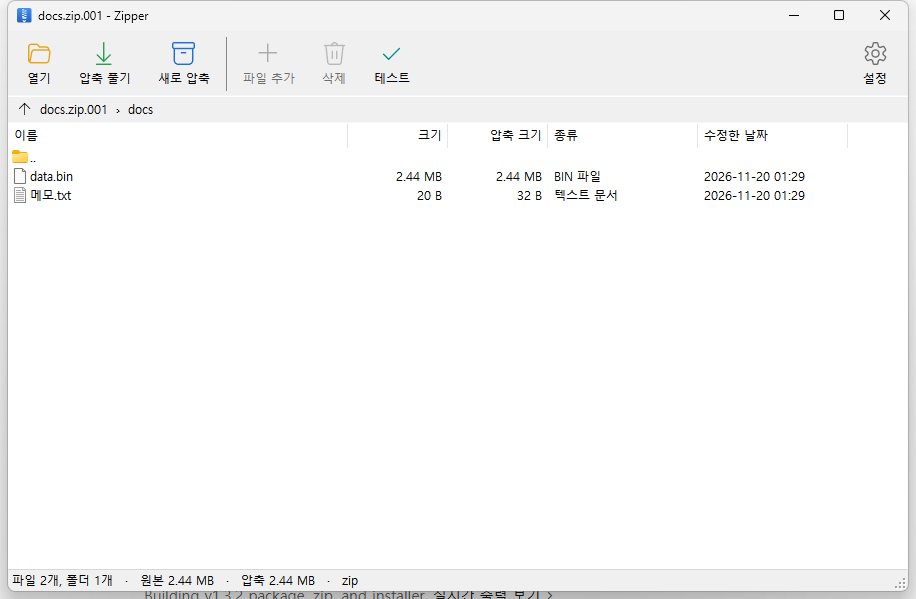

<p align="center">
  
</p>

<h1 align="center">Zipper</h1>

<p align="center">A light, clean archive manager for Windows.</p>

<p align="center">Author: <b>Manggdy</b></p>

<p align="center"><b>English</b> | <a href="README.ko.md">한국어</a></p>



Zipper opens, extracts and creates archives — zip, 7z, rar, tar, gz, iso and more than twenty other formats, including split archives. It is a small C# WinForms app (about 70 KB) that drives the bundled 7-Zip engine, and it plugs into Explorer with a right-click menu and file associations.

## Download

Get `ZipperSetup-<version>.exe` from the [Releases](https://github.com/mrkim0118/Zipper/releases/latest) page and run it. It installs per user without admin rights; choose "install for all users" in the first dialog if you want that.

## Features

- **Browse archives like folders**: open any archive, walk its folders, sort by name, size, type or date, and double-click a file to open it.
- **Extract many formats**: zip, 7z, rar/rar5, tar, gz/tgz, bz2, xz, zst, lzma, cab, iso, wim, arj, lzh, cpio, rpm, deb, xar, z and more, plus the Korean ALZ and EGG formats (including encrypted and split ones).
- **Create archives**: zip, 7z, tar, tar.gz, tar.bz2, tar.xz, gz, bz2, xz and wim, with 6 compression levels — every format the 7-Zip engine can write (rar, alz, egg, iso and the others can only be extracted). The compress window lists the chosen files and folders; add more, drop them in, or remove some before compressing.
- **Split archives**: create volumes of any size (10 MB, 700 MB CD, 4092 MB FAT32, or a custom size such as `50 MB`), and open `.001`, `.z01` and `.part1.rar` sets directly.
- **Passwords**: ZipCrypto or AES-256 for zip, AES-256 with encrypted file names for 7z. A wrong password is caught before extraction, so no empty files are left behind.
- **Smart extract**: one top-level item goes next to the archive; several items go into a new folder named after the archive.
- **Explorer menu**: plain files and folders get compress…, one-click ZIP / 7Z; archives also get smart extract, extract here, extract each to a new folder, extract to…, open and test. Selecting many files makes one archive; selecting many archives extracts each one. The menu is added on first launch, even without the installer.
- **EXE renaming (optional)**: store `.exe` files as `.zipper` so mail services accept the archive, with an `EXE 복원하기.bat` at the archive root that renames them back for people without Zipper. Zipper itself turns `.zipper` back into `.exe` when extracting (and drops the batch file). On by default; turn it off in the compress dialog or Settings.
- **Default program**: associate 29 archive types with Zipper from Settings or the installer.
- **Drag and drop**: drop an archive to open it, drop files to compress them or add them to the open archive, drag files out of an archive into Explorer.
- **Edit and test**: add, delete and rename (F2) files in zip, 7z, tar and wim archives; test an archive for damage.
- **Search and recent files**: find files by name across the whole archive (Ctrl+F); reopen recent archives from the Open button or the start screen.
- **One archive per item**: compress each selected file or folder into its own archive.
- **Progress**: speed, time left, and "2/3" when several archives are processed in a row; the password of one archive is tried first on the next.
- **Safe defaults**: existing files are kept by renaming the new one, unless you choose overwrite or skip. Files extracted from a downloaded archive keep the "from the internet" mark, so SmartScreen and Office Protected View still apply.
- **Korean names from macOS**: decomposed Hangul names in archives made on a Mac are restored to normal Hangul on extraction.
- **Update check**: On launch, checks the latest GitHub release and asks whether to download and install the new version.

## Requirements

- Windows 10 or 11, x64 (ARM64 runs it through x64 emulation)
- .NET Framework 4.8 (already part of Windows 10 1903+ and Windows 11)

## Usage

Open Zipper from the Start menu, then drop an archive or files onto the window, or use the toolbar. In Explorer, right-click a file or folder: the Zipper commands sit directly in the menu with their icons (on Windows 11 under **Show more options**).

### Keyboard shortcuts

| Key | Action |
|---|---|
| `Ctrl+O` | Open an archive |
| `Ctrl+N` | New archive |
| `Ctrl+E` | Extract selected items (all if none selected) |
| `Enter` / double-click | Open the folder or file |
| `Backspace` | Up one folder |
| `Delete` | Delete selected items from the archive |
| `Ctrl+A` | Select all |
| `F5` | Reload |

### Command line

| Command | Action |
|---|---|
| `Zipper.exe <archive>` | Open in the archive browser |
| `Zipper.exe /xsmart <archive>...` | Smart extract |
| `Zipper.exe /xhere <archive>...` | Extract next to the archive |
| `Zipper.exe /xfolder <archive>...` | Extract into a new folder |
| `Zipper.exe /t <archive>...` | Test for damage |
| `Zipper.exe /x <archive>...` | Ask where to extract |
| `Zipper.exe /c <files>...` | Compress dialog |
| `Zipper.exe /czip <files>...` / `/c7z` | Compress to `<name>.zip` / `<name>.7z` |
| `Zipper.exe /c:<format> <files>...` | Compress to `<name>.<format>`, e.g. `/c:tar.gz` |
| `Zipper.exe /ceach:<format> <files>...` | One `<item>.<format>` per item |
| `Zipper.exe /register [assoc] [menu]` / `/unregister` | Explorer integration (used by the installer) |

### Default program on Windows 10/11

Windows only lets the user confirm a new default app. After turning on associations, pick Zipper and **Always** the first time you open an archive, or use **Open Windows default apps settings** in Zipper's Settings.

## Data & Settings

| Data | Location |
|---|---|
| Settings (overwrite mode, open folder after extract) | `HKCU\Software\Zipper` |
| File associations and Explorer menu | `HKCU\Software\Classes` (the previous default is restored on uninstall) |
| Files opened from an archive | `%TEMP%\Zipper\<process id>`, removed when the window closes |

## Limitations

- ALZ and EGG are extract-only: they cannot be created, and files cannot be added to or deleted from them.
- RAR can be extracted but not created (RAR creation needs the commercial WinRAR).
- The Explorer menu uses the classic menu, so on Windows 11 it appears under **Show more options**.
- Files dropped into an open archive are added at its root, not the folder you are viewing.
- Split archives and formats other than zip, 7z, tar and wim are read-only.

## Build from Source

### Build

Needs the .NET SDK (any version that builds `net48`) and [Inno Setup 6](https://jrsoftware.org/isinfo.php).

```powershell
powershell -ExecutionPolicy Bypass -File build.ps1
```

The app is in `src/Zipper/bin/Release/net48`, the installer in `Installer/Output`. Zipper.exe, the setup and the uninstaller are signed with a "Manggdy" code signing certificate from the current user's certificate store (`Installer/sign.ps1` creates a self-signed one on first use; other PCs do not trust a self-signed certificate, so use one from a code signing CA for releases). Add `-NoSign` to skip signing.

### Test

Both scripts use the Release build. The GUI test moves the mouse and types, so leave the PC alone while it runs.

```powershell
powershell -ExecutionPolicy Bypass -File tests/cli-test.ps1
```

```powershell
powershell -STA -ExecutionPolicy Bypass -File tests/gui-test.ps1
```

### Release

Raise `Version` in `src/Zipper/Zipper.csproj` and `AppVersion` in `Installer/Zipper.iss`, then run `build.ps1`. To update the engine, copy `7z.exe`, `7z.dll` and `License.txt` from a 7-Zip x64 install into `ThirdParty/7-Zip`. To redraw the icon, run `Assets/make-icon.ps1`.

## Project Layout

| Path | Contents |
|---|---|
| `src/Zipper/Program.cs` | Entry point, command line, merging Explorer multi-selection |
| `src/Zipper/MainForm.cs` | Archive browser window |
| `src/Zipper/Dialogs.cs` | Compress, extract and settings dialogs |
| `src/Zipper/ProgressForm.cs` | Progress window with cancel |
| `src/Zipper/Egg.cs` | ALZ / EGG reader with the same commands and output as the 7z wrapper |
| `src/Zipper/Ops.cs` | Extract / compress operations and password check |
| `src/Zipper/SevenZip.cs` | 7z.exe wrapper: runs commands, parses listings and progress |
| `src/Zipper/Shell.cs` | Settings, file associations, Explorer menu |
| `src/Zipper/Ui.cs` | Fonts, icon glyphs, shell file icons, password prompt |
| `ThirdParty/7-Zip` | Bundled 7-Zip engine and its license |
| `Installer/Zipper.iss` | Inno Setup script |
| `Assets` | Icon, icon generator, screenshots |
| `tests` | CLI and GUI end-to-end tests |
| `tests/data` | ALZ / EGG samples from the EggDotNet test suite |
| `build.ps1` | Builds the app and the installer |
| `src/Zipper/GitHubUpdater.cs` | GitHub release update check |

## Libraries

- [7-Zip](https://www.7-zip.org/) by Igor Pavlov — compression engine (GNU LGPL, with the unRAR restriction; see `ThirdParty/7-Zip/License.txt`)
- [EggDotNet](https://github.com/akolman/EggDotNet) by Andrew Kolman — ALZ / EGG extraction (MIT)
- [Inno Setup](https://jrsoftware.org/isinfo.php) — installer
